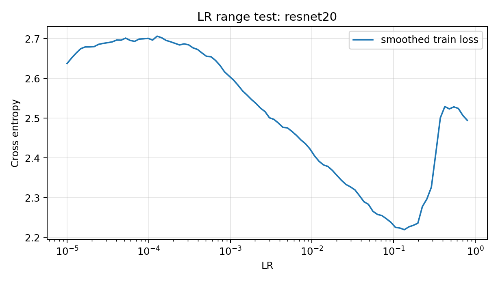
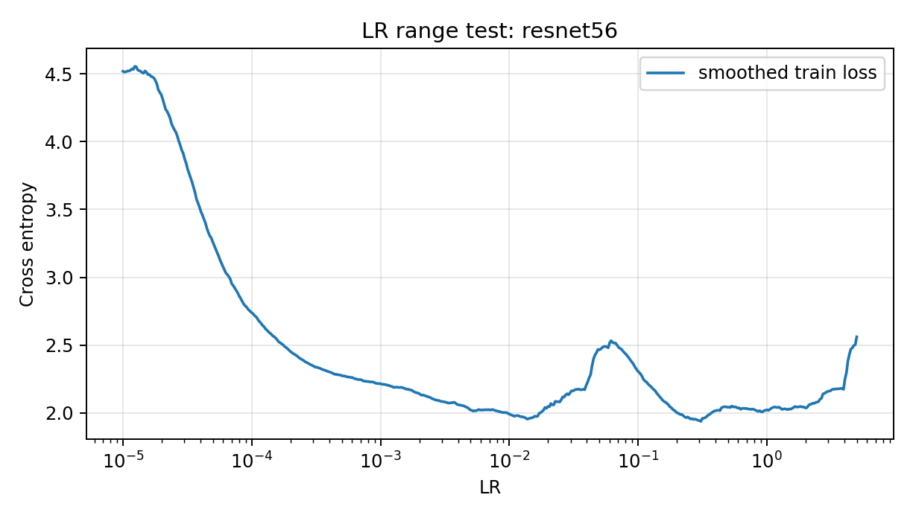
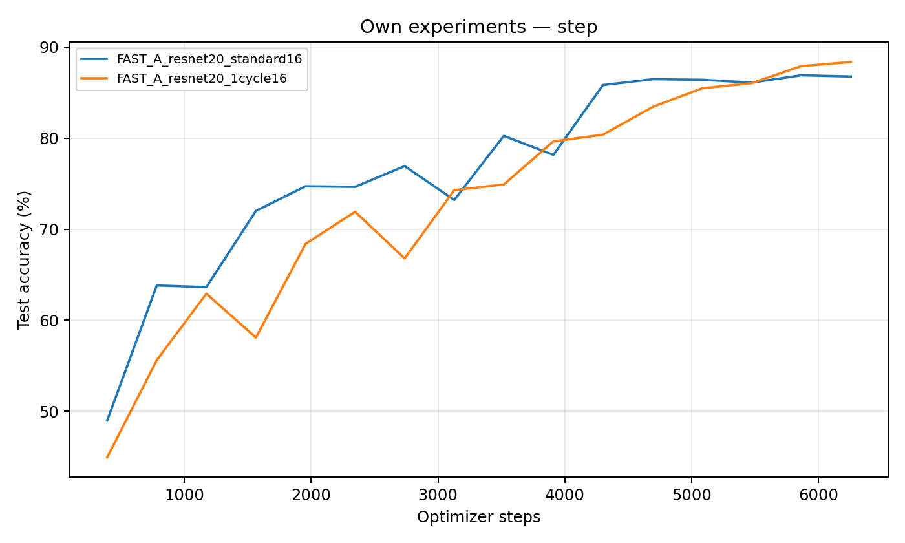
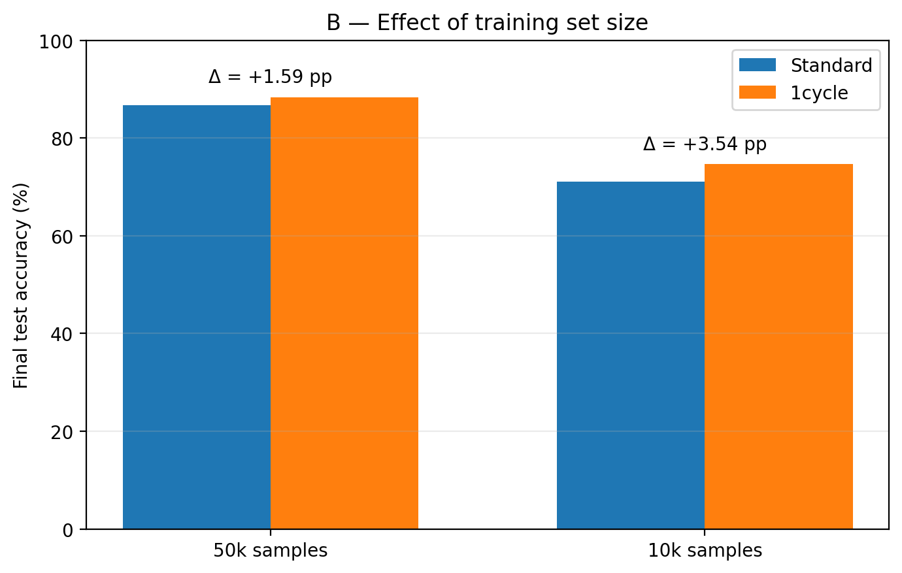
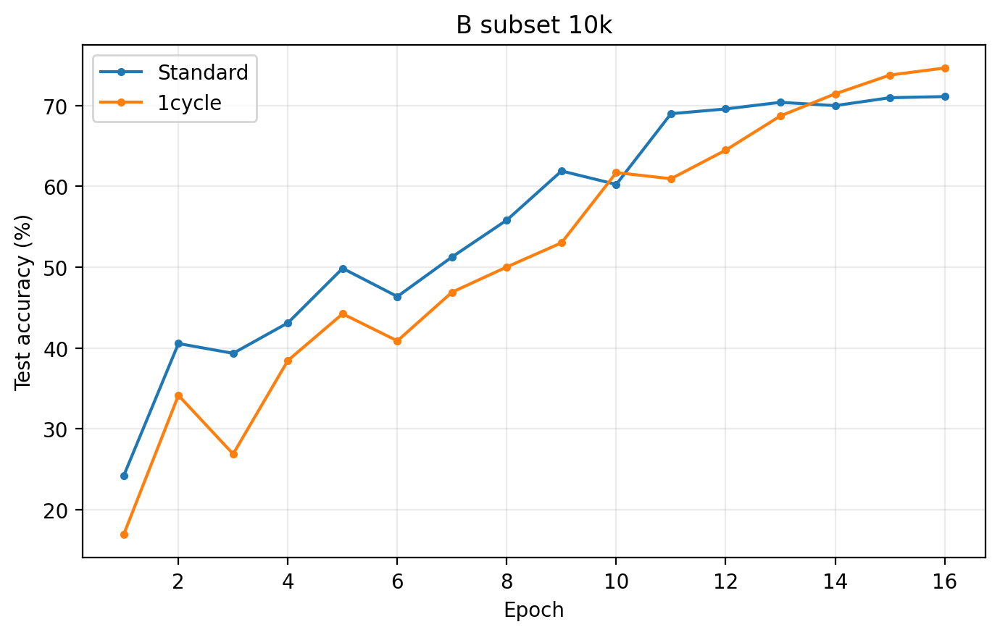
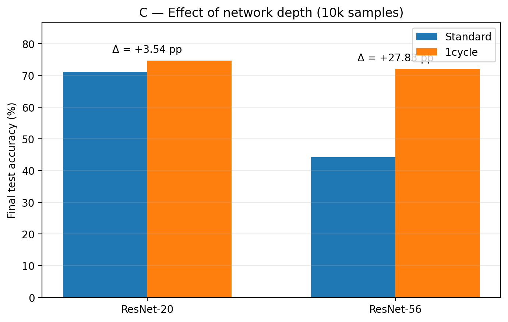
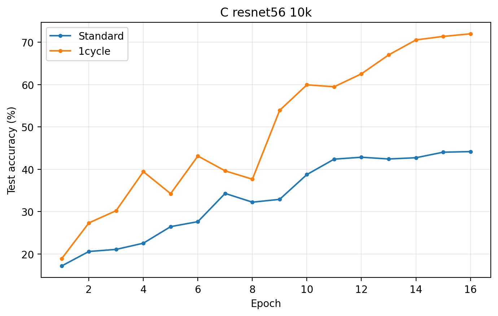
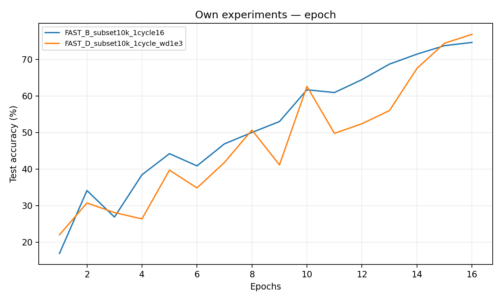
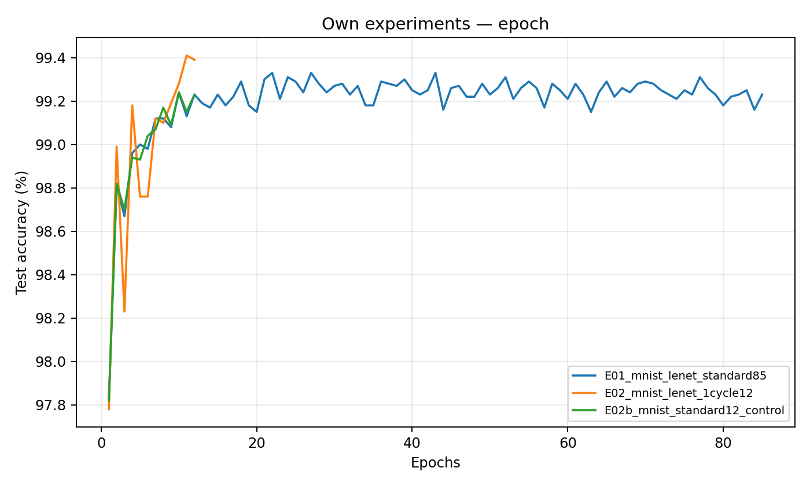

# Отчёт о воспроизведении: Super-Convergence
## 1. Цель и исследовательские вопросы

Авторы исследуют ускорение обучения при одном цикле изменения learning rate с высоким максимумом (1cycle). Помимо скорости они обсуждают обобщение, влияние размера обучающей выборки, глубины сети и баланса регуляризации.

Мы проверяли четыре вопроса:

1. A — обучение: даёт ли 1cycle более высокую точность и быстрее ли достигает заданного качества?
2. B — данные: увеличивается ли преимущество 1cycle, если сократить число обучающих примеров?
3. C — глубина: сохраняется ли эффект при переходе от ResNet-20 к ResNet-56?
4. D — регуляризация: ухудшает ли повышенный weight decay результат 1cycle?

## 2. Условия воспроизведения

| Компонент | Использованные настройки |
|---|---|
| Аппаратная среда | NVIDIA Tesla T4, Google Colab (Linux) |
| Библиотеки | PyTorch `2.11.0+cu130`, torchvision `0.26.0+cu130` |
| Датасеты | MNIST (60k train), CIFAR-10 (50k train); в B–D стратифицированная фиксированная подвыборка 10k |
| Оценивание | Исходная test-выборка; accuracy и cross-entropy после каждой эпохи |
| Архитектуры | LeNet; CIFAR ResNet-20 и ResNet-56 с residual shortcut типа A (PyTorch-адаптация) |
| Оптимизатор | SGD, batch size 128, seed 42 |
| Повторения | 1 seed на конфигурацию; ошибок стандартного отклонения не вычисляли |

Выбор сделан исходя из доступного времени на одной T4: попытались подойти со стороны проверки и подтверждения теоритических гипотез автора на менее маштабных эксперементах, вместо точного повторения результатов работы.

### Подбор LR

Для ResNet-20 тест из 90 шагов выявил ухудшение training loss после области примерно 0.2–0.3; для основного запуска взят `max_lr=0.15`. Для 1cycle выбрали `max_lr=0.30`. Выбор эмпирический (отчасти опираясь на результаты авторов для ResNet-56), без полноценного перебора гиперпараметров.

*Рис. 1. Диагностический LR range test ResNet-20; сглаженный training loss.*

*Рис. 2. Расширенный LR range test ResNet-56; форма кривой зависит и от длины теста.*

## 3. Эксперимент A — 1cycle против обычного обучения

Гипотеза: при равном числе шагов 1cycle улучшит итоговую test accuracy и, возможно, ускорит достижение целевых значений accuracy. Обучали ResNet-20 на всех 50k CIFAR-10 по 16 эпох / 6256 шагов.

| Режим | Финальная accuracy | Лучшая accuracy | Время обучения |
|---|---:|---:|---:|
| Standard (piecewise) | 86.77% | 86.90% | 432.9 с (7.22 мин) |
| 1cycle, max LR 0.15 | 88.36% | 88.36% | 421.1 с (7.02 мин) |

Итоговая разница: +1.59 процентного пункта в пользу 1cycle. Для нескольких заданных порогов baseline оказался впереди:

| Порог test accuracy | Standard: первая эпоха / шаг | 1cycle: первая эпоха / шаг |
|---|---:|---:|
| 75% | 7 / 2737 | 10 / 3910 |
| 80% | 9 / 3519 | 11 / 4301 |
| 85% | 11 / 4301 | 13 / 5083 |

Вывод A: гипотеза об улучшении *финальной* accuracy подтвердилась в нашей постановке; тезис о более быстром достижении порогов 75–85% не подтвердился. Преимущество проявилось к концу короткого обучения. (Не могу не отметить, что результаты при большем количестве эпох могли бы быть интереснее)

*Рис. 3. Test accuracy в зависимости от числа optimizer steps для ResNet-20 (50k).* 

## 4. Эксперимент B — влияние объёма обучающих данных

Гипотеза: при меньшем числе размеченных примеров преимущество 1cycle над Standard становится больше. Использованы результаты A на 50k и два дополнительных запуска ResNet-20 на 10k; во всех случаях 16 эпох, но из-за размера выборки число шагов различается (6256 против 1264).

| Train samples | Standard (final) | 1cycle (final) | Выигрыш 1cycle |
|---|---:|---:|---:|
| 50 000 | 86.77% | 88.36% | +1.59 п.п. |
| 10 000 | 71.12% | 74.66% | +3.54 п.п. |

На меньшей выборке преимущество увеличилось на 1.95 п.п. (с 1.59 до 3.54). Это согласуется с направлением эффекта в статье, где выигрыш CLR также рос при сокращении данных.

*Рис. 4. Итоговая test accuracy для полных 50k и подвыборки 10k CIFAR-10.*

*Рис. 5. Обучение ResNet-20 на 10k примеров, стандартный режим и 1cycle.*

Вывод B: подтвердилась в выбранной постановке гипотеза о большем *относительном выигрыше в accuracy* при уменьшении данных. Однако сравниваются одинаковые эпохи, а не одинаковое общее число шагов между 50k и 10k. Кроме того, использован только один seed и два размера выборки.

## 5. Эксперимент C — влияние глубины ResNet

Гипотеза: эффект 1cycle сохраняется при изменении глубины архитектуры. Сравнивали ResNet-20 (результаты B) и ResNet-56 на одинаковой подвыборке 10k, 16 эпох / 1264 шагов, batch size 128. Максимальный LR подбирался отдельно для архитектур: 0.15 для ResNet-20 и 0.30 для ResNet-56.

| Архитектура | Standard (final) | 1cycle (final) | Выигрыш 1cycle |
|---|---:|---:|---:|
| ResNet-20 | 71.12% | 74.66% | +3.54 п.п. |
| ResNet-56 | 44.17% | 72.00% | +27.83 п.п. |

*Рис. 6. Сравнение итоговой test accuracy на подвыборке 10k CIFAR-10.*

*Рис. 7. Сходимость ResNet-56 на коротком бюджете; baseline не достиг качества ResNet-20.*

Вывод C: 1cycle оказался лучше baseline для обеих глубин. Standard ResNet-56 здесь практически не успел обучиться (44.17%), поэтому разница главным образом отражает неудачную сходимость конкретного baseline за 16 эпох. В отличие от оригинальной статьи, у нас относительный выигрыш больше на более глубокой модели, это как раз может обьясняться недостаточным обучением.

## 6. Эксперимент D — weight decay и регуляризация

Гипотеза: более сильный weight decay может мешать обучению с большим LR. Зафиксированы ResNet-20, 10k, 1cycle с LR 0.01 → 0.15 → 0.0001, 16 эпох; изменялся только weight decay.

| Weight decay | Финальная test accuracy | Train accuracy | Финальный test loss |
|---|---:|---:|---:|
| 1e-4 | 74.66% | 78.08% | 0.7456 |
| 1e-3 | 76.87% | 79.26% | 0.6822 |

Более высокий weight decay улучшил test accuracy на +2.21 п.п., а не ухудшил её.

*Рис. 8. 1cycle на 10k CIFAR-10 при двух значениях weight decay.*

Вывод D: в нашей постановке гипотеза об ухудшении при 1e-3 не подтвердилась. Мы проверили только две точки, без `weight_decay=0` и значений выше 1e-3.

## 7. Дополнительная проверка — MNIST / LeNet

Для проверки общего подхода воспроизведено сравнение LeNet на MNIST с конфигурациями, близкими по смыслу к Table 2 оригинальной работы.

| Режим | Эпохи | Финальная test accuracy | Лучшая test accuracy |
|---|---:|---:|---:|
| Standard (inverse LR) | 85 | 99.23% | 99.33% |
| Standard (контроль, 12 эпох) | 12 | 99.23% | 99.24% |
| 1cycle (циклический momentum) | 12 | 99.39% | 99.41% |

При одинаковых 12 эпохах 1cycle улучшил финальную test accuracy на +0.16 п.п.; при этом превзошёл и 85-эпоховый Standard по финальной accuracy (+0.16 п.п.). Для 1cycle потребовалось 5628 шагов против 39865 у длинного baseline. По best accuracy разница с длинным baseline — +0.08 п.п.. Это один запуск каждого режима, без доверительных интервалов.

*Рис. 9. Test accuracy LeNet на MNIST. Сравнение по эпохам; для 85-эпохового baseline горизонтальная шкала шире.*

## 8. Сопоставление со статьёй и ограничения

Что проверили: основной режим 1cycle против Standard; влияние количества данных; глубины; двух значений weight decay; дополнительный LeNet/MNIST. Данные, параметры и графики сохранены в `report_artifacts/`; конфигурации всех запусков — в `*/config.json`, метрики — в `*/metrics.json`, кривые — в `*/history.csv`.

Что существенно отличается от оригинала:

- В статье использовали Caffe и многопроцессорные GPU-системы, в этой работе — PyTorch и одна Tesla T4. Реализация ResNet (включая stem, shortcut и BatchNorm) не бит-в-бит совпадает с Caffe-архитектурой из Supplemental Materials.
- Вместо длинных запусков (например, 10k против 80k итераций для ResNet-56 в Figure 1a) все основные CIFAR-сравнения проводились только по 16 эпох. В CIFAR эксперименте A это 6256 шагов, в B–D — 1264 шага.
- Batch size — 128, тогда как в Table 2 оригинальной статьи указан общий batch 512, а для многих результатов ResNet-56 — около 1000. Поэтому выбранные максимальные LR нельзя переносить напрямую.
- В оригинальных опытах 1cycle часто менял momentum и подбирал режим регуляризации; в наших основных CIFAR-опытах momentum зафиксирован на 0.9 для отделения эффекта LR schedule. На MNIST циклический momentum включён.
- Для CIFAR-10 у нас фиксирована одна BN-настройка (`momentum=0.05` в PyTorch), в то время как в исходной статье BN MAF и прочие параметры могли различаться между режимами.
- Имеется только один random seed; абсолютные значения и небольшие различия accuracy не имеют оценки разброса.
- Для выбора LR использован train loss range test, а не полностью идентичный оригинальному test accuracy range test. Выбранные максимумы отличаются от статьи.

Что не воспроизводили: ImageNet (ResNet-50 / Inception-ResNet-v2), Wide ResNet, DenseNet и CIFAR-100; исследование batch size; полную зависимость от максимального LR, dropout и momentum.

## 9. Итог

| Вопрос | Результат нашей проверки |
|---|---|
| A: 1cycle эффективнее | Частично: выше финальная accuracy (+1.59 п.п.), но медленнее раннее достижение порогов |
| B: выигрыш растёт при меньших данных | Да, в этом эксперименте: +1.59 п.п. на 50k против +3.54 п.п. на 10k |
| C: эффект сохраняется при большей глубине | Да для двух сетей, но результат ResNet-56 осложнён коротким baseline |
| D: высокий weight decay мешает | Нет при 1e-3: accuracy повысилась на +2.21 п.п.; вывод ограничен двумя значениями |
| MNIST | 1cycle: 99.39% за 12 эпох; Standard: 99.23% за 85 эпох |

---

